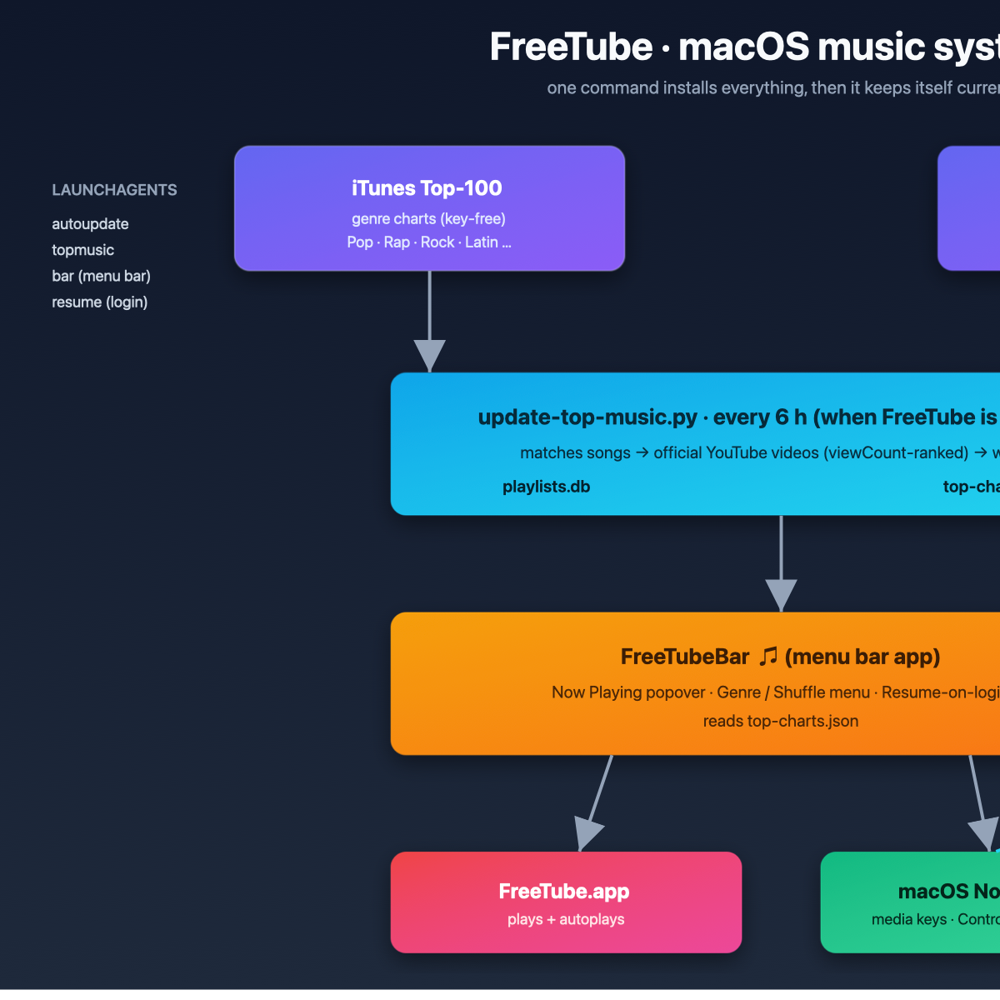
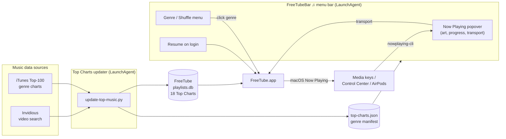

# FreeTube macOS installer

Installs the official [FreeTube](https://freetubeapp.io/) macOS release with SHA-256 verification, writes a tuned base config, generates the Top Charts music playlists, installs the menu bar app, and registers the auto-updater and login helpers — all from a single command. Companion to [freetube-configs](https://github.com/ZeroXSHDW/freetube-configs-main), which holds the portable settings, curated playlists, and profiles.

## Showcase

▶ **Live interactive 3D viewer:** <https://zeroxshdw.github.io/freetube-install/>

An orbit/zoom 3D scene of the whole system (menu bar, 18 genre nodes, Radio Mix, Now Playing). Embed it on any site:

```html
<iframe src="https://zeroxshdw.github.io/freetube-install/"
        style="width:100%;height:640px;border:0;border-radius:16px;"
        title="FreeTube macOS Music System" loading="lazy"></iframe>
```

## Native macOS app (Swift)

The installer scripts are now wrapped in a full **SwiftUI macOS application** — `FreeTubeInstaller` — a single `.app` that replaces the standalone scripts and menu bar app:

| Module | What it does |
| --- | --- |
| **Install / Update** | Downloads the official DMG, verifies SHA-256 + code signature, removes quarantine, installs to `~/Applications`. |
| **Now Playing** | Drives FreeTube via `freetube://` deep links + `nowplaying-cli`, with an **endless genre queue** and automatic track advance. |
| **SponsorBlock** | Auto-skips sponsor / self-promo / intro / outro / filler segments (sponsor.ajay.app) while FreeTube plays. |
| **Library** | Reads FreeTube's own `history.db` / `subscriptions.db` / `favorites.json` / `watchLater.json` and stays in sync with FreeTubeBar. |
| **Extras** | Sleep-aware pause/resume, LaunchAgent toggles, snapshot backups + restore, log cleanup, and a one-click **Doctor**. |
| **Menu bar ♫** | Native `NSStatusItem` popover with Now Playing, favorites, and quick genre launcher. |

### Build

```bash
cd freetube-install
swift build                                   # build from source
./scripts/build-app.sh --install              # assemble + sign FreeTubeInstaller.app → ~/Applications
open ~/Applications/FreeTubeInstaller.app
```

> Requires Swift 5.9+ (Xcode Command Line Tools). The app uses no third-party dependencies — pure Swift + system frameworks.

Source lives under `Sources/FreeTubeApp/` (Models, Views, ViewModels, Services, Helpers).

## Why this exists

FreeTube's macOS builds are **ad-hoc signed, not notarized**, so the Homebrew cask is disabled and Gatekeeper blocks the app by default. This installer:

1. Downloads the release DMG from GitHub and verifies its SHA-256 digest (the same value published by GitHub and by the Homebrew cask).
2. Verifies the app bundle's code signature after install.
3. Removes the quarantine attribute so macOS allows it to run.
4. Optionally restores a config snapshot from `freetube-configs`.
5. Installs three LaunchAgents:
   - **FreeTube auto-update** (login + every 6 h).
   - **Top Charts refresh** (login + every 6 h) — keeps 18 genre playlists updated with the most popular music in each genre.
   - **FreeTubeBar** — a native menu-bar app (♫ icon) with Now Playing controls and a click-to-play genre menu.

> The release DMG is **not** committed here (GitHub rejects files over 100 MB). The installer always downloads the current release and verifies its digest.

## Requirements

- macOS 12 or newer, Apple Silicon (`arm64`) or Intel (`x64`)
- `curl`, `python3`, and Xcode Command Line Tools (`hdiutil`, `codesign`, `xattr`, `shasum` are included with the CLT)

## Install

```bash
git clone https://github.com/ZeroXSHDW/freetube-configs-main.git
git clone https://github.com/ZeroXSHDW/freetube-install.git
cd freetube-install
./install.sh
```

The default install:

- Places `FreeTube.app` in `~/Applications` (no admin password needed).
- Writes a tuned base config (or restores `../freetube-configs-main` if present).
- Generates the **18 Top Charts music playlists** immediately.
- Installs the auto-updater, Top Charts updater, menu bar app, and resume helper.
- Launches FreeTube.

Options:

```bash
./install.sh --version 0.25.3            # pin a version
./install.sh --system                    # install to /Applications (needs sudo; no auto-update)
./install.sh --no-config                 # skip config snapshot restore
./install.sh --config-dir /path/to/config
./install.sh --skip-charts               # don't generate Top Charts playlists now
./install.sh --menu-bar-now-playing      # show Now Playing in the menu bar
./install.sh --no-launch
```

## Update

Updates are automatic for per-user installs. To force an immediate check:

```bash
launchctl kickstart -k gui/$(id -u)/local.freetube.autoupdate
# or run it directly:
~/Library/Scripts/FreeTubeAutoUpdate.sh
```

Logs: `~/Library/Logs/FreeTubeAutoUpdate.log`. The updater skips while FreeTube is running and never replaces the app without verifying the digest and signature.

## Top Charts auto-update

FreeTube has no built-in "auto-populate trending" feature, so this repo adds one. It:

1. Pulls the iTunes Top 100 charts for **18 genres** (Pop, Hip-Hop/Rap, Rock, Country, R&B/Soul, Electronic, Dance, Alternative, Latin, Reggae, Jazz, Classical, Blues, Singer/Songwriter, World, Soundtrack, Russian Rap, Russian Pop).
2. Resolves each song to its official YouTube video via Invidious — matching on title/artist, **ranked by view count**, and skipping live streams and non-music/mis-matched results.
3. Drops removed videos and writes one FreeTube playlist per genre (`Top Charts — <Genre>`), plus a **Radio Mix** (a shuffled cross-genre playlist of the top tracks) and a manifest the menu bar app reads.

It runs at login and every 6 hours, but only when FreeTube is **closed** (editing the database under a running app would be overwritten). To refresh now:

```bash
~/Library/Scripts/update-top-music.sh --force   # quits, refreshes, relaunches
~/Library/Scripts/update-top-music.sh --dry-run # preview without changing anything
```

Logs: `~/Library/Logs/FreeTubeTopMusic.log`.

## Menu bar app (FreeTubeBar)

A native Swift menu-bar item (♫) compiled at install time:

- **Left-click** the ♫ for a Now Playing **popover**: album art, title, artist, a draggable **scrub bar**, and Play/Pause / Previous / Next / Shuffle / ♥ / 🕓.
- **Right-click** for the menu:
  - Now Playing title, Play/Pause, Next, Previous, **Shuffle All Genres** (uses the cross-genre Radio Mix).
  - **Genres** — click to play a genre, or **Shuffle `<genre>`** to start it at a random track.
  - **♥ Favorites** and **🕓 Watch Later** — pin the current track, or play any saved item.
  - **Resume last genre on login** (toggle) — remembers what you were playing and auto-resumes it at login.
  - **Refresh Top Charts** — regenerate the charts right now (quits FreeTube, refreshes, relaunches).
  - Open FreeTube, Reload Genres, Quit.

It runs at login and stays in the menu bar. To play a genre from the terminal:

```bash
~/Library/Scripts/play-genre.sh "Hip-Hop/Rap"     # or any genre name
```

Source: `bar/FreeTubeBar.swift` (compiled with `swiftc`, requires Xcode Command Line Tools).

### Favorites (♥) and Watch Later (🕓)

- The ♥ / 🕓 buttons in the popover (or the corresponding menu items) pin the currently playing track instantly to `favorites.json` / `watchLater.json`.
- **♥ Favorites → Play All Favorites** (or **🕓 Watch Later → Play All Watch Later**) merges them into FreeTube's built-in **Favorites** / **Watch Later** playlist and starts playing it.
- Pinned tracks are also merged into FreeTube's playlists automatically on every Top Charts refresh, so they persist and appear inside FreeTube itself.
- The `freetube-configs` companion repo syncs both lists (`config/favorites.json`, `config/watchLater.json`) so they travel with your portable backup.

### AirPods auto-pause

A background watcher (`local.freetube.audiopause`) monitors the default audio output. When AirPods or Bluetooth headphones are removed and the audio falls back to the built-in speakers, it **pauses FreeTube** so music doesn't suddenly play out loud. It only acts when FreeTube is the active Now Playing app.

### Notifications

The Top Charts updater posts a macOS notification each time it finishes a refresh, so you know when the charts have been regenerated.

### Resume on login

When **Resume last genre on login** is on, the last genre you played is recorded to `~/Library/Application Support/FreeTube/last-genre.json`, and a login LaunchAgent re-opens it in FreeTube a few seconds after you sign in. Turn the toggle off in the ♫ menu to disable it.

## How it works





Layered, isometric-style view of the same flow:

```
                 ┌──────────────────────────────┐
                 │      FreeTubeBar  ♫          │   menu bar (top of screen)
                 │  popover · genres · resume   │
                 └──────────────┬───────────────┘
                                │ click genre / shuffle / resume-on-login
        ┌───────────────┐       ▼
        │ iTunes Top-100│   ┌─────────────────────┐   ┌───────────────┐
        │  genre charts │──▶│  update-top-music.py│◀──│   Invidious   │
        └───────────────┘   └──────┬──────────────┘   └───────────────┘
                                   │ writes
                     ┌─────────────┴─────────────┐
                     ▼                           ▼
        ┌───────────────────────┐   ┌───────────────────────┐
        │     playlists.db      │   │    top-charts.json    │
        │  18 "Top Charts"      │   │  genre → video IDs     │
        └───────────┬───────────┘   └───────────┬───────────┘
                    ▼                           │ (read by bar)
        ┌───────────────────────┐               │
        │     FreeTube.app      │◀──────────────┘
        │  plays + autoplays    │
        └───────────┬───────────┘
                    ▼
        ┌───────────────────────┐
        │  macOS Now Playing    │   media keys · Control Center · AirPods
        └───────────────────────┘
```

Everything is orchestrated by three LaunchAgents: `autoupdate`, `topmusic`, and `bar` (plus `resume` for login resume).

## Verify / troubleshoot

```bash
./verify.sh                      # app, signature, updater, config sanity
./scripts/freetube-doctor.sh     # install + network + Now Playing diagnostics
```

## Uninstall

```bash
./uninstall.sh           # remove app and updater, keep your data
./uninstall.sh --purge   # also move ~/Library/Application Support/FreeTube aside
```

## Docs

- [docs/media-keys-and-now-playing.md](docs/media-keys-and-now-playing.md)
- [docs/troubleshooting-playback.md](docs/troubleshooting-playback.md)

## Layout

```text
Package.swift                           Swift package manifest
Sources/FreeTubeApp/                    Native SwiftUI app (Models/Views/ViewModels/Services/Helpers)
scripts/build-app.sh                    Assemble + sign FreeTubeInstaller.app
install.sh                              Main installer
uninstall.sh
verify.sh
bar/FreeTubeBar.swift                   Menu bar app source
bar/audiodevice.swift                   Default audio output helper (CoreAudio)
scripts/freetube-autoupdate.sh          Checksum-verified auto-updater
scripts/update-top-music.py             Top Charts playlist generator (18 genres)
scripts/update-top-music.sh             Top Charts wrapper
scripts/play-genre.sh                   Play a genre from the CLI
scripts/resume-last.sh                  Resume last genre on login
scripts/play-favorites.sh               Flush + play ♥ favorites
scripts/play-watch-later.sh             Flush + play 🕓 watch later
scripts/audio-pause.sh                  AirPods auto-pause watcher
scripts/freetube-doctor.sh              Diagnostics
launchd/                                LaunchAgent templates
docs/
```

## License

MIT — see [LICENSE](LICENSE).
